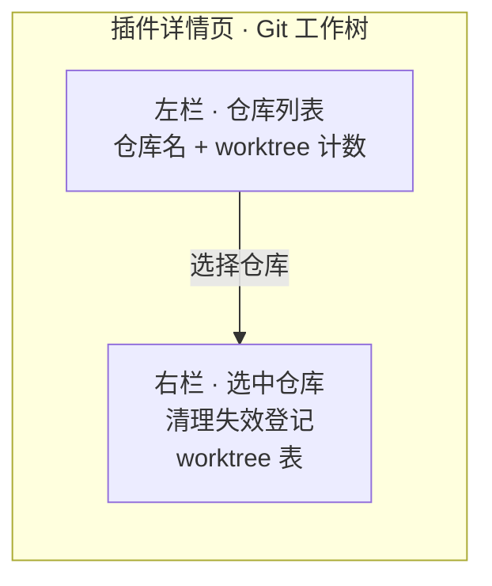
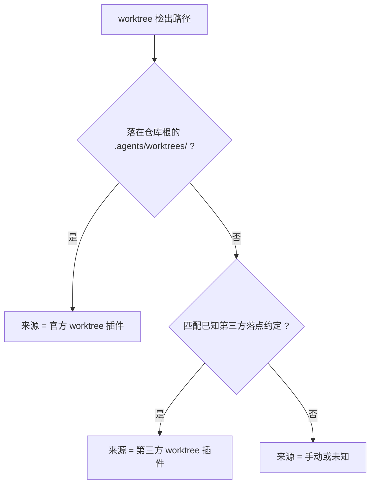

# Worktree Sessions - Plan

## Goal Capsule

- **Objective:** 给 DeepSeek Harness 补上 worktree 的两个缺口——(A) 一个能看到并手动清理全部 worktree 的管理页；(B) composer 里的一个 Worktree 开关，让空白会话能一键在自动创建的 worktree 里开工。
- **Product authority:** 用户本人——dsh 的重度使用者，同时维护多个仓库与多个 worktree 插件，需要并行推进多个独立需求并各自独立提交、独立测试。单人工具，没有第二类使用者。
- **Delivery shape:** 两个特性都做在 dsh 仓库内的实验性可选 bundle 里，复用官方构建链；A 挂在插件详情页，B 挂在 composer。
- **Open blockers:** 无。
- **Readiness note:** 特性 A 已到 implementation-ready（含 Planning Contract 与 6 个实施单元）；**特性 B 目前只有需求，尚未规划**。

---

## Product Contract

### 范围说明

本 Product Contract 覆盖两个特性：

- **特性 A — Worktree 管理页**：Requirements `R1`–`R12`，Acceptance Examples `AE1`–`AE4`；已完成规划。
- **特性 B — Composer Worktree 开关**：Requirements `R13`–`R19`，Acceptance Examples `AE5`–`AE8`；仅需求，尚未规划。

下面第一节到 `### Sources / Research` 属特性 A；`### 特性 B：Composer Worktree 开关` 起属特性 B。

### Summary

（特性 A）在插件详情页里增加一个 worktree 管理页：左栏列出全部已注册仓库（带 worktree 计数），选中后右栏显示该仓库的 worktree 表，每行给出检出路径、分支、基点提交、改动状态与来源。页面提供两个操作：清理失效登记，以及删除指定 worktree（二次确认）。

### Problem Frame

官方实验性 worktree 插件只负责「创建并进入」，创建完就把检出目录与分支留在磁盘上——没有清单、没有清理、没有回收路径。同一台机器上还并存着另外两个 worktree 插件（各自有不同的落点约定）与手动创建的 worktree，结果是残留持续累积，而用户没有任何界面能看到它们。

用户当前的替代做法是逐仓库敲 `git worktree list`，再判断哪些能删，再敲 `git worktree prune` 或 `git worktree remove`。单仓库单 worktree 时这个做法够用；仓库一多、来源一杂，判断成本就超过收益。用户已明确表示命令行不便于查看与手动操作。

### Key Decisions

**列出全部 worktree 并标注来源，而不是只列本插件自己创建的。** 存量残留来自三个不同的 worktree 插件加手动创建；只列「自己的」无法解决用户真正的痛点。

**来源靠路径模式推断，不维护注册表。** 官方 worktree 有稳定落点（仓库根下的 `.agents/worktrees/`），第三方各有自己的落点约定，因此来源可以在无状态的前提下推断出来。代价是任何插件改变默认落点都会让该来源降级为「手动或未知」。选择它是因为自建注册表要求挂进创建路径，而官方运行时不向外暴露创建事件。

**remove 允许强删，但必须二次确认并列出会丢失的文件。** 存量残留往往带着未提交改动，一律拒绝删除会让页面失去价值。作为交换，确认步骤必须具体到文件名，而不是一句泛泛的「此操作不可撤销」。

**主从式布局，右栏承载详情。** 仓库数量少时读起来清楚，且页面高度恒定——仓库变多不会把页面拉长。

**页面挂在插件详情页，作用域是全部已注册仓库。** 插件详情页是全局设置区，没有「当前会话」上下文，因此不提供「只看当前仓库」的快捷视图；用户通过左栏切换仓库。

### Key Flows

- F1. 查看与清理
  - **Trigger:** 用户打开插件详情页。
  - **Steps:** 枚举全部已注册仓库；逐仓库读取 worktree 列表与改动状态；归类每条的来源；渲染左栏计数与右栏表格。
  - **Outcome:** 用户一眼看到全部 worktree、各自来源、以及是否干净。
  - **Covers:** R1–R6

- F2. 删除一个 worktree
  - **Trigger:** 用户在右栏某行触发删除。
  - **Steps:** 先查该条是否干净；干净则直接进入确认，不干净则在确认里列出会丢失的文件；用户确认后执行删除。
  - **Outcome:** 目标 worktree 被移除，其他 worktree 与仓库主检出不受影响。
  - **Covers:** R7–R10

### Requirements

**列表与呈现**

- R1. 页面列出全部已注册 workspace 所对应的仓库，并给出每个仓库的 worktree 数量。
- R2. 左栏为仓库列表，右栏为当前选中仓库的 worktree 表；页面高度不随仓库数量增长。
- R3. 每个 worktree 行显示：检出路径、分支名（脱离 HEAD 时明确标注）、基点提交、是否有未提交改动。
- R4. 仓库没有任何 worktree 时，右栏给出明确的空状态，而不是空白。

**来源标注**

- R5. 每个 worktree 行标注来源，取值至少覆盖：官方 worktree 插件、第三方 worktree 插件、手动或未知。
- R6. 来源判定依据检出路径的落点约定，不要求用户手工登记。

**操作**

- R7. 每个仓库提供「清理失效登记」操作：移除那些检出目录已不存在的 worktree 登记，不触碰任何现存目录。
- R8. 每个 worktree 行提供删除操作；执行前必须二次确认。
- R9. 目标 worktree 有未提交改动时，确认内容必须列出会丢失的具体文件。
- R10. 删除一个 worktree 不得影响同仓库其他 worktree、仓库主检出，或该 worktree 所属分支在其他检出的可用性。

**集成与可达性**

- R11. 页面出现在插件详情页内，并跟随官方 worktree 插件那一项的启用状态。
- R12. 页面数据在打开时读取，并提供手动刷新入口；不要求实时推送。

### Acceptance Examples

- AE1. 删除一个干净的 worktree
  - **Given:** 选中的仓库里有一个无未提交改动的 worktree。
  - **When:** 用户在该行触发删除并确认。
  - **Then:** 该 worktree 的检出目录与登记都消失，同仓库其他行不变。
  - **Covers:** R8, R10

- AE2. 删除一个脏 worktree
  - **Given:** 目标 worktree 有 3 个未提交改动。
  - **When:** 用户在该行触发删除。
  - **Then:** 确认内容列出这 3 个文件；用户取消则无任何变化；用户确认后 worktree 被移除且改动丢失。
  - **Covers:** R9

- AE3. 失效登记的清理
  - **Given:** 一个 worktree 的检出目录已被手工删除，但登记仍在。
  - **When:** 用户触发清理失效登记。
  - **Then:** 该登记消失，其他现存 worktree 与目录均不受影响。
  - **Covers:** R7

- AE4. 来源误标是可见的
  - **Given:** 某个第三方插件把 worktree 建在了非约定落点。
  - **When:** 页面渲染该行。
  - **Then:** 该行来源显示为「手动或未知」，而不是被错标成另一个插件的产物。
  - **Covers:** R5, R6

### Success Criteria

- 用户不再需要打开终端就能回答「这台机器上有哪些 worktree、谁建的、能不能删」。
- 存在误标时是可见的误标（落到「手动或未知」），而不是错误的自信标注——误标不会诱导用户误删。
- 清理失效登记是幂等的：重复执行不产生变化也不报错。

### Scope Boundaries

- 不创建 worktree——官方工具已提供，且创建需要会话上下文。
- 不做验收 / apply / 合并 / 退回流程——这是独立的一大块 Git 语义，官方运行时也明确不拥有合并策略。
- 不做定时或自动清理——清理由用户按需触发。
- 不做跨机器或远端仓库的 worktree 管理。

#### Deferred to Follow-Up Work

- 来源判定的兜底信号（例如以 `.git/worktrees/<name>` 的命名特征或检出的创建时间补充推断）。本计划只做落点表；未知落点落「手动或未知」是已接受的降级。
- 已注册仓库数量增长后的懒加载或缓存。当前规模下按需全量扫描足够。
- 浏览器端到端流程的自动化测试。本计划的验证止于人工在浏览器里走一遍。

### Dependencies / Assumptions

- **版本线约束:** 官方实验性 worktree 只存在于 `0.2.1-alpha.2` 线，页面必须跑在该线上。
- **Git 版本:** 目标环境的 Git 需支持 `--no-lazy-fetch`（本机 2.50.1 满足）。
- **仓库规模假设:** 已注册 workspace 为个位数（当前环境 2 个）。数量增长到数十个后，「打开页面即全量扫描」会变慢，届时需要懒加载或缓存。
- **沙箱假设:** 读取与删除 worktree 的 Git 操作需落在会话写策略允许的范围内。
- **落点约定假设:** 来源判定依赖各插件当前的默认落点；约定变化会使来源降级为「手动或未知」。

### Sources / Research

- 官方 worktree 子系统与包边界（`dsh-v0.2.1-alpha.2` 内容）: `docs/subsystems/worktrees.zh.md`、`packages/experimental/worktree/README.zh.md`、`packages/experimental/tool-worktree/README.zh.md`。
- 官方包的能力缺口原句: `.agents/notes/implemented/feature/2026-09-13-explicit-worktree-creation.zh.md`——「该服务不拥有工作树注册表、清理计划、分支合并策略或任务关联数据库」。
- 官方默认落点与忽略文件写入条件: `packages/experimental/worktree/src/index.ts`（`directory` 默认 `.agents/worktrees`）、`packages/experimental/worktree/src/directory.ts`。
- 页面挂载点契约: `packages/client/ui-plugin-manager/src/client/slot-contract.ts` 声明 `plugins.detail.section`，其 subject 联合为 `{kind:'bundle',pkg}` / `{kind:'row',pkg,row}` / `{kind:'item',id}`；用法见 `docs/cookbook/adding-a-settings-card.zh.md` 第 4 节。
- 客户端半边的构建约束: `docs/cookbook/adding-a-settings-card.zh.md` 第 5 节；产物格式由 `packages/client/tsdown.client.ts` 的 `clientBundle` 预设决定，该预设不随任何已发布包发布。
- 远程契约通路: `docs/cookbook/adding-a-remote-api.zh.md` 的五步法，含 `TypertRemoteService` 与 `RemoteError` 码表约定。
- 插件形态与扩展点总览: `docs/cookbook/extension-cookbook.zh.md`。
- 「仓库内、不随官方发行」的可选 bundle 先例: `packages/experimental/voice-input-bundle/cordis.patch.yml`（`- insert` 列出全部件）与其 `package.json`（`dsh.bundle.patch` + `workspace:*` 依赖），配合 `packages/experimental/client-ui-voice-input`。实测三个 `packages/experimental/client-ui-*` 均不在 `packages/bundle/web-app/cordis.patch.yml`。
- 客户端包的构建配置形状: `packages/experimental/client-ui-voice-input/tsdown.config.ts`（`clientBundle('<包名>', ['lib/types/index.js'])`）与其 `package.json` 的 `dsh.client`（含 `external` 数组）。
- 已注册仓库的枚举来源: `ctx.workspaceRegistry`（`packages/api/workspace-controller`）。
- 做完整客户端半边的第三方先例（结构参考）: `dsh-git-worktree`。
- 包清单与注册面的硬性约束: `docs/cookbook/adding-a-package.zh.md`、`packages/client/AGENTS.md` 的 New plugin package checklist、`scripts/check-workspace-constraints.ts`。

### 特性 B：Composer Worktree 开关

#### Summary

在 composer 里给**空白会话**加一个 Worktree 开关：勾选并发出首条 prompt 时，先物化 worktree，再让会话以该目录为 cwd 出生；composer 上常驻一个只读徽章，只表明「当前会话在 worktree 里」。

#### Problem Frame

用户要在同一台机器上并行推进多个独立需求，每个需求各自独立提交、独立测试。今天的做法要么每次手动开目录，要么依赖第三方插件的「新会话勾选」——都没有把「勾选 → 自动建出隔离目录 → 用该目录开会话」压成一步。

同时有一条硬约束必须由产品语义吸收，而不是留给用户去撞：**dsh 的会话 cwd 在创建时写入后不可变**，对已有会话使用不同 cwd 会抛 `ApiSessionCwdConflict`。因此「在一个已经聊起来的会话里换到 worktree」在技术上不可能。

#### Key Decisions

**开关只在空白会话生效。** 对齐「在会话存在之前决定它的出生地」这一语义；已产生消息的会话里开关不可用，用户需另开一个。理由：cwd 不可变，而替换一个进行中的对话会丢掉上下文。

**发送时才物化，原空白会话被替换。** 用户看到的是同一个空白界面变成新会话，实际发生的是「先物化 worktree → 再以该 cwd 创建会话」。理由：只有「会话存在的时刻晚于 worktree 物化的时刻」，cwd 才是对的。

**兑现后勾选态自动归位，隔离态由常驻徽章承担。** 开关不是模式。理由：若照抄 plan / permission 那种可反复开关的模式语义，用户会以为关掉开关能回主仓，而会话其实已经在 worktree 分支上。

**失败 fail-closed。** 准备序列任一步失败即拒绝开跑并报错，绝不静默回落到主仓 cwd。理由：静默回落会产出「以为在隔离、实际在改主仓」的会话，其代价高于任何一次显式失败。

**提交默认会被围栏拒绝，但有一条既有的「一次批准升级」通道。** 写围栏根是会话自己的 cwd，可写范围只有 `[会话 cwd, /tmp, tmpdir()]`；而 worktree 与原仓库**共享 `<主仓>/.git`**，它在围栏之外。因此 worktree 会话里第一次执行写 Git 元数据的命令会被拒（`[sandbox: file access denied under workspace-write mode]`）。但 harness 自带升级通道：变更类工具可携带 `sandbox_permissions` + `justification` 两个参数，经用户批准后以 `danger-full-access` 重跑该次执行——这条路已在 `packages/sandbox/sandbox/src/escalation.ts` 定义（`workspace-write → danger-full-access`），所以「提交 / 推送 / 建 PR」在对话里是可行的，代价是每次都要一次批准。宿主侧提交动作（下条 R19）是把这个代价消掉的可选增强，不是前置条件。

#### Key Flows

- F3. 勾选并首条发送
  - **Trigger:** 用户在一个空白会话里勾选 Worktree 并发出首条 prompt。
  - **Steps:** 判定先决条件（空白、落点可用）→ 物化 worktree → 以该目录为 cwd 创建会话 → 首条 prompt 进入新会话 → 开关归位、徽章出现。
  - **Outcome:** 用户在同一个界面里开始了一个隔离会话，且隔离态可见。
  - **Covers:** R13–R17

- F4. 提交工作树里的改动
  - **Trigger:** 用户触发宿主侧提交动作。
  - **Steps:** 读取工作树的改动 → 汇编提交 → 写出 commit。
  - **Outcome:** 该任务获得一个独立 commit；agent 的 shell 未参与写 Git 元数据。
  - **Covers:** R19

#### Requirements

- R13. composer 提供 Worktree 开关，只在该会话是空白（尚未产生任何消息）时可用；已有消息的会话里该开关不可用。
- R14. 开关勾选后，用户发出首条 prompt 时先物化 worktree，再以该目录为 cwd 创建会话；首条 prompt 原样进入新会话。
- R15. 物化失败时拒绝开跑并报错，不得回落到主仓 cwd 继续。
- R16. 兑现后开关自动归位为关闭；隔离态改由 composer 上的常驻徽章表达。
- R17. 徽章只表明「当前会话在 worktree 里」，不展示分支名、落点或未提交数量。
- R18. 发送失败或用户取消时，不得留下无法追踪的 worktree 产物。
- R19. （可选增强）提供宿主侧提交动作，把该会话在工作树里的改动提交成一个 commit，使提交不必每次依赖沙箱升级批准；不做该增强时，提交仍可经既有升级通道完成。

#### Acceptance Examples

- AE5. 空白会话勾选后发送
  - **Given:** 一个空白会话，Worktree 开关已勾选。
  - **When:** 用户发出首条 prompt。
  - **Then:** 先物化 worktree，再以该目录为 cwd 创建会话；首条 prompt 进入新会话；开关归位为关闭；徽章显示「在 worktree 里」。
  - **Covers:** R13, R14, R16, R17

- AE6. 已聊起的会话
  - **Given:** 一个已经产生过消息的会话。
  - **When:** 用户尝试使用 Worktree 开关。
  - **Then:** 开关不可用（或明确提示需要新建会话），且不产生任何 worktree。
  - **Covers:** R13

- AE7. 物化失败
  - **Given:** 目标落点被占用，或 Git 准备失败。
  - **When:** 用户发送首条 prompt。
  - **Then:** 会话不开始，界面给出错误，且不产生该会话的任何工作目录。
  - **Covers:** R15, R18

- AE8. 在工作树里提交
  - **Given:** 一个在 worktree 里工作的会话，已有未提交改动，且会话处于 `workspace-write`。
  - **When:** 会话执行写 Git 元数据的命令（如提交）。
  - **Then:** 首次被围栏拒绝并报出 `file access denied`；申请升级到 `danger-full-access` 并经用户批准后，同一命令成功执行。若已实现 R19 的宿主侧动作，则提交不必经过该批准。
  - **Covers:** R19

#### Success Criteria

- 用户从「决定要隔离」到「在隔离目录里开始干活」只需要勾一下加一次发送。
- 任何时刻用户都能从 composer 上看出当前会话是否在 worktree 里。
- 失败时用户拿到的是一个明确的错误，而不是一个悄悄跑在主仓的会话。

#### Scope Boundaries

- 不做已聊起会话的原地迁移（会话 cwd 创建后不可变）。
- 不做「每个 prompt 一个新副本」或 best-of-N 扇出。
- 不做 worktree 的回收、TTL、来源标注——那些属特性 A。
- **代价（非限制）:** 在 `workspace-write` 下，worktree 会话里写 Git 元数据的命令**首次会被拒**，需经一次「升级到 `danger-full-access`」的批准才能执行（提交、推送、建 PR 同理）。这是既有通道的行为，不是缺陷；R19 的宿主侧动作可消除这一反复批准的成本。

#### Dependencies / Assumptions

- **顺序假设:** 会话创建的时机必须晚于 worktree 物化的时机。
- **通道假设:** 提交能力在 v1 依赖既有的沙箱升级通道（一次批准一次执行）；R19 的宿主侧动作是消除反复批准的增强。官方运行时只提供 `create()`，开发目标线上也没有可用的第三方 worktree 插件可复用。
- **空白判定假设:** 「空白会话」的标准是「尚未产生任何消息」。
- **落点归属假设:** worktree 的创建使用官方实验性 worktree 服务（仅 `0.2.1-alpha.2` 线），因此仍属原 workspace，只改会话 cwd。
- **打包假设:** 特性 A 与 B 都需要「host 服务 + 客户端半边 + bundle」这同一形状，可在同一个实验性 bundle 内提供，省掉一份打包与三处注册面。
- **依赖:** composer 输入控件的 slot 契约（`conversation.input.*` 族）与既有开关先例。

#### Sources / Research

- 会话 cwd 创建时写入且不可变、冲突即抛 `ApiSessionCwdConflict`：`packages/api/session-controller/src/agent.ts`。
- `session.create` 接受 `workspaceId` 或 `cwd`（互斥），cwd 取值顺序 `workspace?.path ?? request.cwd ?? defaultCwd`：`packages/api/session-controller/src/commands.ts`。
- 写围栏根 = 会话 cwd（`resolve()` 只读 `session.header.cwd`，不查 workspace 实体）：`packages/sandbox/sandbox-policy/src/index.ts`。
- `workspace-write` 的可写根只有三个：`packages/sandbox/sandbox/src/roots.ts`。
- Seatbelt profile 形状（`deny file-write*` + 仅放行上述三个根）：`packages/sandbox/sandbox-local/src/profiles.ts`。
- `ctx.subprocess` 的 spawn 规格不含沙箱策略字段（宿主侧 git 调用不受会话写围栏约束）：`packages/subprocess/subprocess/src/types.ts`。
- composer 输入控件 slot 族与完整开关先例：`packages/client/ui-conversation/src/client/contract/slots.ts`、`packages/client/ui-plan`、`packages/plan/plan-mode`。
- 官方 worktree 不改变 Session 的原始项目，只改工作目录：`docs/subsystems/worktrees.zh.md`（`dsh-v0.2.1-alpha.2`）。
- 沙箱升级通道（拒绝 → 一次批准后以更宽模式重跑）：`packages/sandbox/sandbox/src/escalation.ts`（`ESCALATION_TARGETS`、`workspace-write → danger-full-access`）、`packages/fs/tool-fs/src/sandbox.ts` 与 `packages/core/tools/src/ptc.ts`（`sandbox_permissions` + `justification` 两个参数）。
- 参考实现（**不可依赖**：其 13 个 dsh peer 精确钉 `0.2.0-rc.2`，在 `0.2.1-alpha.2` 线上装不上）：`dsh-git-worktree@0.10.0` 的 `/worktree` 命令族、`lib/session-checkout-apply.js` 的交付状态机、以及用动态 `disabled` 表达式替换官方 workspace UI 的做法。

---

## Planning Contract

**范围:** 本 Planning Contract 与下面的 Implementation Units 只覆盖**特性 A（管理页）**。特性 B（composer 开关）目前只有需求，尚未规划——它的实现单元需要在下一轮 planning 里补齐。

### High-Level Technical Design

三个包构成一个可选的实验性 bundle，照搬 `voice-input-bundle` 的形状：

- **host 服务包**（`packages/experimental/worktree-console`）：一个继承 `TypertRemoteService` 的 Cordis 服务，namespace 取 `worktreeConsole`，把「枚举仓库 → 读 worktree → 归类来源 → 执行 prune/remove」暴露为远程方法，也是所有 Git 操作的落点，经 `ctx.subprocess` 执行。它同时拥有 typert 契约。
- **客户端 UI 包**（`packages/experimental/client-ui-worktree-console`）：纯客户端半边，`dsh.client` + `./client`，用 `ctx.slots.register` 往 `plugins.detail.section` 注入管理区块并消费 host 的远程方法。它没有自己的 typert 入口。
- **聚合 bundle**（`packages/experimental/worktree-console-bundle`）：只有 `cordis.patch.yml` 与依赖声明，把上面两个包以 `- insert` 一次挂上。

数据流单向：页面打开（或手动刷新）→ 调 host 的 list → host 枚举 `ctx.workspaceRegistry` 里的仓库，逐仓库跑 `git worktree list --porcelain` 并读每条的改动状态 → 按落点表归类来源 → 返回结构化行 → 页面渲染。两个动作走同一通路。

### Key Technical Decisions

**KTD-1. 拆三个包，跟随实验区既有的可选 bundle 先例。** 仓库里两种形态都有先例（`packages/experimental/*` 拆成「客户端包 + bundle 包」，`packages/client/ui-plugin-manager` 是单包双半边）。选拆包因为它落在实验区惯例内，并且天然给出「不进官方发行面」的位置。

**KTD-2. 不进 `OPTIONAL_BUNDLES`，也不注册进 web-app bundle。** 因此它不随官方发行，也不会在插件管理器里出现官方开关；启用方式是写进目标 profile 的 `dsh.profile.bundles`。这条是本计划与「官方收录」的分界线，改动它需要重新评估三处注册面。

**KTD-3. 来源判定用内置落点表，未知落点落「手动或未知」。** 官方落点是 `<仓库根>/.agents/worktrees/`；已知第三方落点按各自当前默认前缀匹配；其余一律「手动或未知」。这是唯一能满足「区分第三方与手动」的做法，代价是对方改落点即降级——已作为可接受的降级记入 Deferred。

**KTD-4. Git 操作沿用第三方先例的硬化参数集与沙箱子进程。** 不自己发明调用约定：禁用可选锁、禁用仓库配置的钩子、固定 C locale、清掉调用方的 Git 路由环境变量、设超时与输出上限。理由是这个组合已知能在 dsh 的子进程与沙箱下工作。

**KTD-5. 删除前的改动检查是删除的必要前置，不是可选提示。** 先读改动状态，再据此决定确认内容；取消必须无副作用。

**KTD-6. 保留主从布局，不为仓库数量少做单栏降级。** brainstorm 已选定主从；把它变成实施期判断会在没有数据支撑的情况下抖动界面形态。

**KTD-7. 测试止于包级单元与组件测试。** host 侧用真实临时 Git 仓库（`git init` + `git worktree add`）而不是 mock git 输出——来源判定与失效登记这两类逻辑的错法都藏在真实输出格式里；浏览器端到端不引入。

### Sequencing

U1 先落地骨架与装配面（没有它，后面任何验证都没有落点）。U2 与 U3 相互独立，可在 U1 之后并行。U4 依赖 U2、U3 的产物形状。U5 依赖 U4 的契约。U6 收口构建与本地挂载验证。

---

## Implementation Units

### U1. 三包骨架与装配面

- **Goal:** 建立 host 包、客户端 UI 包、聚合 bundle 三个包的清单与构建配置，使 bundle 能被 profile 装载出条目。
- **Files:** `packages/experimental/worktree-console/package.json`、`packages/experimental/client-ui-worktree-console/package.json`、`packages/experimental/client-ui-worktree-console/tsdown.config.ts`、`packages/experimental/client-ui-worktree-console/src/css-modules.d.ts`、`packages/experimental/worktree-console-bundle/package.json`、`packages/experimental/worktree-console-bundle/cordis.patch.yml`、`tsconfig.host.json`、`tsconfig.client.json`。
- **Patterns:** 照抄 `packages/experimental/client-ui-voice-input`（exports / `dsh.client` / `tsdown.config.ts` 的 `clientBundle` 调用）与 `packages/experimental/voice-input-bundle`（`dsh.bundle.patch` + `- insert` 列表 + `workspace:*` 依赖）。
- **Test Scenarios:** 一个 host 侧 spec 断言 Loader 组合后存在预期的条目 id，且 mock 的 `worktreeConsole` 服务可被取到（方法体可先为空）。
- **Verification:** `pnpm run typecheck` 通过；`--dump-default-config` 输出里能看到 bundle 的条目。

### U2. Git 适配层

- **Goal:** 一个可测的 git 端口，产出结构化 worktree 行，并提供 prune 与 remove 两个写操作。
- **Files:** `packages/experimental/worktree-console/src/git.ts`、`packages/experimental/worktree-console/src/types.ts`、`packages/experimental/worktree-console/tests/git.host.spec.ts`。
- **Patterns:** KTD-4 的硬化参数集；进程句柄与输出经 `ctx.subprocess`。
- **Test Scenarios:** 临时仓库上 `git worktree add` 后读到该行且字段正确；手工删掉检出目录后再读，该行被识别为失效登记且 prune 只清它；对有未提交改动的 worktree 读到具体改动文件列表；路径不存在时返回空而不抛错。
- **Verification:** `npx vitest run packages/experimental/worktree-console/tests/git.host.spec.ts` 全绿。

### U3. 仓库枚举与来源判定

- **Goal:** 从已注册 workspace 得到仓库清单，并按落点表给每个 worktree 归类来源。
- **Files:** `packages/experimental/worktree-console/src/workspaces.ts`、`packages/experimental/worktree-console/src/sources.ts`、`packages/experimental/worktree-console/tests/sources.host.spec.ts`。
- **Patterns:** 经 `ctx.workspaceRegistry` 取仓库（以 `packages/api/workspace-controller` 的公开面为准）；落点表是一张可读的前缀表，不是散落的 if。
- **Test Scenarios:** 官方落点 → 官方；每个已知第三方落点 → 第三方；未知落点 → 手动或未知；`.agents/worktrees` 与 `.agents/worktree` 这类相邻前缀不互相误匹配；无 worktree 的仓库产出空表而非缺项。
- **Verification:** `npx vitest run packages/experimental/worktree-console/tests/sources.host.spec.ts` 全绿。

### U4. 远程契约

- **Goal:** 把 list / prune / remove 暴露为远程方法，并给出可断言的失败码。
- **Files:** `packages/experimental/worktree-console/src/index.ts`、`packages/experimental/worktree-console/tests/worktree-console.host.spec.ts`。
- **Patterns:** `docs/cookbook/adding-a-remote-api.zh.md` 的五步法；`TypertRemoteService` + `@Remote`；失败统一走 `RemoteError` 与 declare merging 的码表，不建域异常家族。
- **Test Scenarios:** remove 一个不存在的目标 → 断言失败码与 details；remove 一个脏目标而未经确认 → 断言被拒绝且仓库无变化；list 在空仓库上返回空数组而不是失败。
- **Verification:** `pnpm run typecheck` 通过（host 与 client 两个 program）；`npx vitest run packages/experimental/worktree-console/tests/worktree-console.host.spec.ts` 全绿。

### U5. 客户端管理区块

- **Goal:** 在插件详情页渲染主从管理区块，含来源标签、prune 与带确认的 remove。
- **Files:** `packages/experimental/client-ui-worktree-console/src/client/index.tsx`、`packages/experimental/client-ui-worktree-console/src/client/slot-contract.ts`、`packages/experimental/client-ui-worktree-console/tests/console.client.spec.tsx`。
- **Patterns:** 照抄 `packages/client/ui-plugin-manager/src/client/` 的 slots 注册与 subject 过滤；对不属于官方 worktree bundle 的 subject 返回 `null`；远程结果判 `code` 而非 `instanceof`。
- **Test Scenarios:** 列表渲染出仓库计数与行字段；空仓库渲染空状态；脏行确认里出现具体文件列表；取消确认后不发出写调用；来源标签三种取值各自渲染正确。
- **Verification:** `npx vitest run packages/experimental/client-ui-worktree-console/tests/console.client.spec.tsx` 全绿。

### U6. 构建产物与本地挂载验证

- **Goal:** 产出可被客户端模块系统加载的半边，并把 bundle 挂进目标 profile 后人工验证。
- **Files:** `packages/experimental/client-ui-worktree-console/tsdown.config.ts`、`packages/experimental/worktree-console-bundle/cordis.patch.yml`、目标 profile 的 `package.json`。
- **Patterns:** `dsh.client.external` 只登记超出客户端基线模块表的说明符；`clientBundle` 预设产出的 lazy-CJS 工厂格式不做手工改动。
- **Test Scenarios:** 构建后 `lib/client.js` 存在；`--dump-default-config` 出现三个条目且无报错；在目标 profile 上启动后插件详情页可见管理区块，并对一个仓库执行 list 与 prune。
- **Verification:** `pnpm run build:lib` 成功且产物齐全；上面的人工走查通过。

---

## Verification Contract

| 命令 | 覆盖单元 | 通过信号 |
|---|---|---|
| `pnpm run typecheck` | U1–U5 | 退出码 0，host 与 client 两个 program 都过 |
| `npx vitest run packages/experimental/worktree-console packages/experimental/client-ui-worktree-console` | U2–U5 | 全部 spec 通过 |
| `pnpm run lint` | 全部 | 退出码 0 |
| `pnpm run build:lib` | U6 | 产出 `lib/client.js` 与 typert 产物 |
| `dsh --profile <目标 profile> --dump-default-config` | U1, U6 | 输出含 bundle 的条目 |
| 人工走查（目标 profile 启动后） | U5, U6 | 管理区块可见；list / prune 生效；脏目标删除前列出文件 |

---

## Definition of Done

- 特性 A：三个包的 `typecheck`、`lint`、单元与组件测试全部通过。
- 特性 A：`--dump-default-config` 在目标 profile 上输出预期条目，无加载报错。
- 特性 A：人工走查覆盖列表与来源标签正确、空状态、prune 幂等、干净删除、脏删除的确认内容与取消无副作用。
- 官方发行面未被触碰：`packages/bundle/web-app/cordis.patch.yml` 与 `packages/bundle/web-app/package.json` 无改动，`OPTIONAL_BUNDLES` 未新增条目。
- 特性 A：产品合同中的四条验收示例在人工走查里各被走过一次。
- 特性 B：**尚未规划**——进入实施前需先补齐它的 Implementation Units，并至少验证两条端到端路径：「空白会话勾选 → 发送 → worktree 物化 → 新会话 cwd 正确」，以及「在 worktree 会话里提交 → 首次被拒 → 批准升级 → 提交成功」。
- 特性 B：已确认 `dsh-git-worktree` **不作为依赖**（其 peer 精确钉 `0.2.0-rc.2`），文档中只保留为参考实现。
