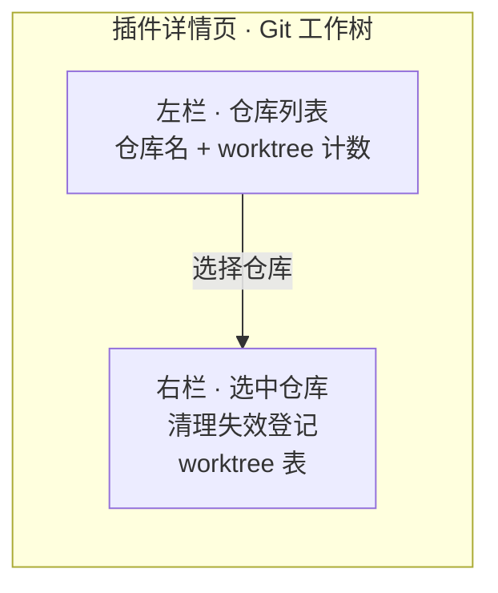
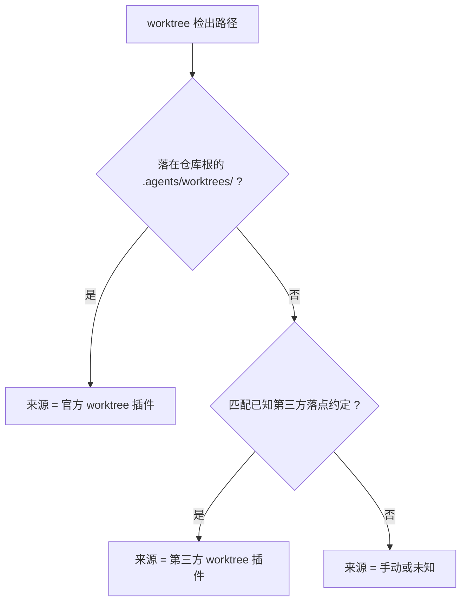

# Worktree Sessions - Plan

## Goal Capsule

- **Objective:** 给 DeepSeek Harness 补上 worktree 的两个缺口——(A) 一个能看到并手动清理全部 worktree 的管理页；(B) composer 里的一个 Worktree 开关，让空白会话能一键在自动创建的 worktree 里开工，并在该隔离会话里直接提交。
- **Product authority:** 用户本人——dsh 的重度使用者，同时维护多个仓库与多个 worktree 插件，需要并行推进多个独立需求并各自独立提交、独立测试。单人工具，没有第二类使用者。
- **Delivery shape:** 两个特性都做在 dsh 仓库内的实验性可选 bundle 里，复用官方构建链；A 挂在插件详情页，B 挂在 composer。B 不新建会话、不放宽权限模式，只把会话的**当前工作目录**指向 worktree。**两个特性都不碰任何官方包**：composer 开关占用 `ui-conversation` 已对外开放的 `conversation.input.left` 扩展位（见 U7），因此不新增 slot、不编辑其骨架。
- **Open blockers:** 无。
- **Readiness note:** 特性 A 已到 implementation-ready（含 Planning Contract 与 6 个实施单元，U1–U6）；**特性 B 已补齐规划**（U7–U9），核心结论是「不换会话、不动权限」。

---

## Product Contract

### 范围说明

本 Product Contract 覆盖两个特性：

- **特性 A — Worktree 管理页**：Requirements `R1`–`R12`，Acceptance Examples `AE1`–`AE4`；已完成规划。
- **特性 B — Composer Worktree 开关**：Requirements `R13`–`R18`，Acceptance Examples `AE5`–`AE8`；已规划（实施单元 `U7`–`U9`）。

下面第一节到 `### Sources / Research` 属特性 A；`### 特性 B：Composer Worktree 开关` 起属特性 B。

### Summary

（特性 A）在插件详情页里增加一个 worktree 管理页：左栏列出全部已注册仓库（带 worktree 计数），选中后右栏显示该仓库的 worktree 表，每行给出检出路径、分支、基点提交、改动状态与来源。页面提供两个操作：清理失效登记，以及删除指定 worktree（二次确认）。

### Problem Frame

官方实验性 worktree 插件只负责「创建并进入」，创建完就把检出目录与分支留在磁盘上——没有清单、没有清理、没有回收路径。同一台机器上还并存着另外两个 worktree 插件（各自有不同的落点约定）与手动创建的 worktree，结果是残留持续累积，而用户没有任何界面能看到它们。

用户当前的替代做法是逐仓库敲 `git worktree list`，再判断哪些能删，再敲 `git worktree prune` 或 `git worktree remove`。单仓库单 worktree 时这个做法够用；仓库一多、来源一杂，判断成本就超过收益。用户已明确表示命令行不便于查看与手动操作。

### Key Decisions

**列出全部 worktree 并标注来源，而不是只列本插件自己创建的。** 存量残留来自三个不同的 worktree 插件加手动创建；只列「自己的」无法解决用户真正的痛点。

**来源靠路径模式推断，不维护注册表。** 官方 worktree 有稳定落点（仓库根下的 `.agents/worktrees/`），第三方各有自己的落点约定，因此来源可以在无状态的前提下推断出来。代价是任何插件改变默认落点都会让该来源降级为「手动或未知」。选择它是因为自建注册表要求挂进创建路径，而官方运行时不向外暴露创建事件。

**remove 允许强删，但必须二次确认并列出会丢失的文件。** 存量残留往往带着未提交改动，一律拒绝删除会让页面失去价值。作为交换，确认步骤必须具体到文件名，而不是一句泛泛的「此操作不可撤销」。

**主从式布局，右栏承载详情。** 仓库数量少时读起来清楚，且页面高度恒定——仓库变多不会把页面拉长。

**页面挂在插件详情页，作用域是全部已注册仓库。** 插件详情页是全局设置区，没有「当前会话」上下文，因此不提供「只看当前仓库」的快捷视图；用户通过左栏切换仓库。

### Key Flows

- F1. 查看与清理
  - **Trigger:** 用户打开插件详情页。
  - **Steps:** 枚举全部已注册仓库；逐仓库读取 worktree 列表与改动状态；归类每条的来源；渲染左栏计数与右栏表格。
  - **Outcome:** 用户一眼看到全部 worktree、各自来源、以及是否干净。
  - **Covers:** R1–R6

- F2. 删除一个 worktree
  - **Trigger:** 用户在右栏某行触发删除。
  - **Steps:** 先查该条是否干净；干净则直接进入确认，不干净则在确认里列出会丢失的文件；用户确认后执行删除。
  - **Outcome:** 目标 worktree 被移除，其他 worktree 与仓库主检出不受影响。
  - **Covers:** R7–R10

### Requirements

**列表与呈现**

- R1. 页面列出全部已注册 workspace 所对应的仓库，并给出每个仓库的 worktree 数量。
- R2. 左栏为仓库列表，右栏为当前选中仓库的 worktree 表；页面高度不随仓库数量增长。
- R3. 每个 worktree 行显示：检出路径、分支名（脱离 HEAD 时明确标注）、基点提交、是否有未提交改动。
- R4. 仓库没有任何 worktree 时，右栏给出明确的空状态，而不是空白。

**来源标注**

- R5. 每个 worktree 行标注来源，取值至少覆盖：官方 worktree 插件、第三方 worktree 插件、手动或未知。
- R6. 来源判定依据检出路径的落点约定，不要求用户手工登记。

**操作**

- R7. 每个仓库提供「清理失效登记」操作：移除那些检出目录已不存在的 worktree 登记，不触碰任何现存目录。
- R8. 每个 worktree 行提供删除操作；执行前必须二次确认。
- R9. 目标 worktree 有未提交改动时，确认内容必须列出会丢失的具体文件。
- R10. 删除一个 worktree 不得影响同仓库其他 worktree、仓库主检出，或该 worktree 所属分支在其他检出的可用性。

**集成与可达性**

- R11. 页面出现在插件详情页内，并跟随官方 worktree 插件那一项的启用状态。
- R12. 页面数据在打开时读取，并提供手动刷新入口；不要求实时推送。

### Acceptance Examples

- AE1. 删除一个干净的 worktree
  - **Given:** 选中的仓库里有一个无未提交改动的 worktree。
  - **When:** 用户在该行触发删除并确认。
  - **Then:** 该 worktree 的检出目录与登记都消失，同仓库其他行不变。
  - **Covers:** R8, R10

- AE2. 删除一个脏 worktree
  - **Given:** 目标 worktree 有 3 个未提交改动。
  - **When:** 用户在该行触发删除。
  - **Then:** 确认内容列出这 3 个文件；用户取消则无任何变化；用户确认后 worktree 被移除且改动丢失。
  - **Covers:** R9

- AE3. 失效登记的清理
  - **Given:** 一个 worktree 的检出目录已被手工删除，但登记仍在。
  - **When:** 用户触发清理失效登记。
  - **Then:** 该登记消失，其他现存 worktree 与目录均不受影响。
  - **Covers:** R7

- AE4. 来源误标是可见的
  - **Given:** 某个第三方插件把 worktree 建在了非约定落点。
  - **When:** 页面渲染该行。
  - **Then:** 该行来源显示为「手动或未知」，而不是被错标成另一个插件的产物。
  - **Covers:** R5, R6

### Success Criteria

- 用户不再需要打开终端就能回答「这台机器上有哪些 worktree、谁建的、能不能删」。
- 存在误标时是可见的误标（落到「手动或未知」），而不是错误的自信标注——误标不会诱导用户误删。
- 清理失效登记是幂等的：重复执行不产生变化也不报错。

### Scope Boundaries

- 不创建 worktree——官方工具已提供，且创建需要会话上下文。
- 不做验收 / apply / 合并 / 退回流程——这是独立的一大块 Git 语义，官方运行时也明确不拥有合并策略。
- 不做定时或自动清理——清理由用户按需触发。
- 不做跨机器或远端仓库的 worktree 管理。

#### Deferred to Follow-Up Work

- 来源判定的兜底信号（例如以 `.git/worktrees/<name>` 的命名特征或检出的创建时间补充推断）。本计划只做落点表；未知落点落「手动或未知」是已接受的降级。
- 已注册仓库数量增长后的懒加载或缓存。当前规模下按需全量扫描足够。
- 浏览器端到端流程的自动化测试。本计划的验证止于人工在浏览器里走一遍。

### Dependencies / Assumptions

- **版本线约束:** 官方实验性 worktree 只存在于 `0.2.1-alpha.2` 线，页面必须跑在该线上。
- **Git 版本:** 目标环境的 Git 需支持 `--no-lazy-fetch`（本机 2.50.1 满足）。
- **仓库规模假设:** 已注册 workspace 为个位数（当前环境 2 个）。数量增长到数十个后，「打开页面即全量扫描」会变慢，届时需要懒加载或缓存。
- **沙箱假设:** 读取与删除 worktree 的 Git 操作需落在会话写策略允许的范围内。
- **落点约定假设:** 来源判定依赖各插件当前的默认落点；约定变化会使来源降级为「手动或未知」。

### Sources / Research

- 官方 worktree 子系统与包边界（`dsh-v0.2.1-alpha.2` 内容）: `docs/subsystems/worktrees.zh.md`、`packages/experimental/worktree/README.zh.md`、`packages/experimental/tool-worktree/README.zh.md`。
- 官方包的能力缺口原句: `.agents/notes/implemented/feature/2026-09-13-explicit-worktree-creation.zh.md`——「该服务不拥有工作树注册表、清理计划、分支合并策略或任务关联数据库」。
- 官方默认落点与忽略文件写入条件: `packages/experimental/worktree/src/index.ts`（`directory` 默认 `.agents/worktrees`）、`packages/experimental/worktree/src/directory.ts`。
- 页面挂载点契约: `packages/client/ui-plugin-manager/src/client/slot-contract.ts` 声明 `plugins.detail.section`，其 subject 联合为 `{kind:'bundle',pkg}` / `{kind:'row',pkg,row}` / `{kind:'item',id}`；用法见 `docs/cookbook/adding-a-settings-card.zh.md` 第 4 节。
- 客户端半边的构建约束: `docs/cookbook/adding-a-settings-card.zh.md` 第 5 节；产物格式由 `packages/client/tsdown.client.ts` 的 `clientBundle` 预设决定，该预设不随任何已发布包发布。
- 远程契约通路: `docs/cookbook/adding-a-remote-api.zh.md` 的五步法，含 `TypertRemoteService` 与 `RemoteError` 码表约定。
- 插件形态与扩展点总览: `docs/cookbook/extension-cookbook.zh.md`。
- 「仓库内、不随官方发行」的可选 bundle 先例: `packages/experimental/voice-input-bundle/cordis.patch.yml`（`- insert` 列出全部件）与其 `package.json`（`dsh.bundle.patch` + `workspace:*` 依赖），配合 `packages/experimental/client-ui-voice-input`。实测三个 `packages/experimental/client-ui-*` 均不在 `packages/bundle/web-app/cordis.patch.yml`。
- 客户端包的构建配置形状: `packages/experimental/client-ui-voice-input/tsdown.config.ts`（`clientBundle('<包名>', ['lib/types/index.js'])`）与其 `package.json` 的 `dsh.client`（含 `external` 数组）。
- 已注册仓库的枚举来源: `ctx.workspaceRegistry`（`packages/api/workspace-controller`）。
- 做完整客户端半边的第三方先例（结构参考）: `dsh-git-worktree`。
- 包清单与注册面的硬性约束: `docs/cookbook/adding-a-package.zh.md`、`packages/client/AGENTS.md` 的 New plugin package checklist、`scripts/check-workspace-constraints.ts`。

### 特性 B：Composer Worktree 开关

#### Summary

在 composer 里给**空白会话**加一个 Worktree 开关：勾选并发出首条 prompt 时先物化 worktree，再把该会话的**当前工作目录**指到它；composer 上常驻一个只读徽章，表明本会话的工作树是哪一个。会话本身不更换，权限模式也不动。

#### Problem Frame

用户要在同一台机器上并行推进多个独立需求，每个需求各自独立提交、独立测试。今天的做法要么每次手动开目录，要么依赖第三方插件的「新会话勾选」——都没有把「勾选 → 自动建出隔离目录 → 直接在该目录里干活」压成一步。

这里有一个容易误判的技术前提，值得写清：**会话有两层目录概念**——出生时冻结、不可变的 `header.cwd`，以及可变的「当前工作目录」（由工作目录服务记录、可回放、当前目录消失时回落到原始项目）。**沙箱写围栏取的是前者**，而后者正是工作树该去的地方。把这两者混为一谈，就会得出「换目录必须新建会话」以及「在 worktree 里提交必须放宽权限」这两个错误结论。

#### Key Decisions

**开关只在空白会话生效，理由是任务边界。** 中途开工作树会让之前在检出里做的改动混进来，「隔离一个任务」就不干净了。这是产品选择，不是技术限制——当前工作目录本来就可以随时改。

**不换会话，只改「当前工作目录」。** 物化完成后用工作目录服务把该会话的当前目录指向工作树；会话身份、权限模式、对话上下文全部不变。理由：`header.cwd` 本就不需要变；换会话会丢掉对话上下文，还要额外处理旧会话的去处。

**落点用官方默认，即在检出根内。** `<检出根>/.agents/worktrees/<名字>`。理由有两条且互相加强：一是官方服务的 `directory` 被硬校验为「相对且不含点段」，出不了检出根；二是检出根内的落点让**围栏根（= `header.cwd` = 检出根）同时罩住工作树与 `.git`**，于是标准模式就够用，不需要放宽任何权限。

**兑现后勾选态自动归位，状态由常驻徽章承担。** 开关不是模式。理由：若照抄 plan / permission 那种可反复开关的模式语义，用户会以为关掉开关就能回主仓，而会话的当前目录其实已经指向工作树。

**失败 fail-closed。** 物化失败即拒绝开跑并报错，绝不静默回落到原目录。理由：静默回落会产出「以为在隔离、实际在改检出」的会话，其代价高于任何一次显式失败。

**不动权限模式。** 提交要写的 `.git` 与工作树本身都在围栏内，标准模式直接通过。理由：放宽权限是这个功能最容易犯的过度反应——一旦放宽，围栏整体消失，工作树就从「安全边界」降为「改动边界」，而这里并不需要付这个代价。

#### Key Flows

- F3. 勾选并首条发送
  - **Trigger:** 用户在一个空白会话里勾选 Worktree，并发出首条 prompt。
  - **Steps:** 判定先决条件（会话空白、落点可用）→ 物化 worktree → 把该会话的当前工作目录指向工作树 → 首条 prompt 照常处理 → 开关归位、徽章出现。
  - **Outcome:** 用户在同一个会话里继续工作，但当前目录已是那棵隔离的树；隔离态可见。
  - **Covers:** R13–R17

- F4. 在工作树里提交与推送
  - **Trigger:** 当前目录已指向工作树的会话执行 git 写操作。
  - **Steps:** agent 正常提交、推送、建 PR。
  - **Outcome:** 提交与推送在既有权限模式下直接成功，无批准请求；各任务各自独立提交。
  - **Covers:** R18

#### Requirements

- R13. composer 提供 Worktree 开关，只在该会话是空白（尚未产生任何消息）时可用；已有消息的会话里不可用。
- R14. 开关勾选后，用户发出首条 prompt 时先物化 worktree，再把该会话的当前工作目录指向工作树；首条 prompt 照常处理。会话身份与权限模式不变，也不新建会话。
- R15. 物化失败时拒绝开跑并报错，不得静默回落到原目录；发送失败或用户取消时，不得留下无法追踪的 worktree 产物。
- R16. 兑现后开关自动归位为关闭；状态改由 composer 上的常驻徽章表达。
- R17. 徽章表明「本会话的工作树是哪一个」，不展示未提交数量。
- R18. 在指向工作树的会话里提交与推送，必须在该会话**既有的权限模式下**直接通过：不要求任何权限放宽，也不产生逐次批准请求。

#### Acceptance Examples

- AE5. 空白会话勾选后发送
  - **Given:** 一个空白会话，Worktree 开关已勾选。
  - **When:** 用户发出首条 prompt。
  - **Then:** 先物化 worktree，再把该会话的当前工作目录指向它；首条 prompt 照常处理；开关归位为关闭；chip 转为只读徽章态显示本会话的工作树；会话 id 与权限模式都没变。
  - **Covers:** R13, R14, R16, R17

- AE6. 已聊起的会话
  - **Given:** 一个已经产生过消息的会话。
  - **When:** 用户尝试使用 Worktree 开关。
  - **Then:** 开关不可用（并说明本开关仅对空白会话开放），且不产生任何 worktree。
  - **Covers:** R13

- AE7. 物化失败
  - **Given:** 目标落点被占用，或 Git 准备失败。
  - **When:** 用户发送首条 prompt。
  - **Then:** 会话不切换目录，界面给出错误，且不产生该会话的任何工作目录。
  - **Covers:** R15

- AE8. 在工作树里提交与推送
  - **Given:** 会话的当前目录已指向工作树，已有未提交改动，权限模式为部署默认的 `workspace-write`。
  - **When:** agent 执行提交与推送。
  - **Then:** 两者直接成功，**没有任何批准请求**；不需要把会话切到更宽的模式。
  - **Covers:** R18

#### Success Criteria

- 用户从「决定要隔离」到「在隔离目录里开始干活」只需要勾一下加一次发送。
- 任何时刻用户都能从 composer 上看出本会话挂着哪棵工作树。
- 失败时用户拿到的是一个明确的错误，而不是一个悄悄跑在原目录的会话。

#### Scope Boundaries

- 不做已聊起会话的原地进入（开关仅对空白会话开放——这是任务边界的选择，见 Key Decisions）。
- 不做「每个 prompt 一个新副本」或 best-of-N 扇出。
- 不做 worktree 的回收、TTL、来源标注与清单——那些属特性 A。
- 本特性只负责**进入**工作树；离开沿用既有的工作目录服务，不做专门的出口 UI。
- **隔离强度是约定级**：围栏根是检出根，因此覆盖整个检出（含主检出）。工作树保证的是「任务之间的改动互不混淆」，不是「agent 碰不到检出里的其它地方」。
- **不做**：为这个功能放宽权限模式（一旦放宽，围栏消失，而这里是刻意保留围栏的）。

#### Outstanding Questions

- **Deferred to Planning:** `gh` 为建 PR 可能在 `$HOME` 下写配置或缓存，那会落在围栏之外——提交与推送本身不受影响（都写检出根内的 `.git`），但建 PR 这条路径需要实测确认。
- **Deferred to Planning:** 右侧栏文件树根是否跟随「当前工作目录」。第三方实现称它取 `header.cwd` 且创建后不可变（该插件整个存在的理由就是绕这一点），而工作目录服务的文档说所选目录会出现在用户上下文中。以哪个为准，实现时确认。

#### Dependencies / Assumptions

- **两层目录假设:** 会话的 `header.cwd` 出生时冻结、且是写围栏根；「当前工作目录」可变、可回放、消失时回落到原始项目。
- **落点假设:** 用官方实验性 worktree 服务建树（仅 `0.2.1-alpha.2` 线），其 `directory` 只能是检出根内的相对路径；本特性不改它。
- **模式假设:** 该会话的权限模式是部署默认（`workspace-write`）；在检出根内工作树与 `.git` 都在围栏内，因此无需放宽。
- **依赖:** composer 输入控件的 slot 契约（`conversation.input.*` 族）、工作目录服务、以及既有开关先例。

#### Sources / Research

- **会话有两层目录（关键）:** `packages/session/working-directory/README.zh.md`——「改变一个 Session 的工作目录…所选目录可通过回放恢复…当前目录消失时，只要原始项目仍然存在，就恢复到原始项目」；官方 worktree 走的是 `ctx.workingDirectory.set(agent, path, signal)`（`packages/experimental/worktree/src/index.ts:170`），**不改 `header.cwd`**。
- **围栏根 = `session.header.cwd`:** `packages/sandbox/sandbox-policy/src/index.ts` 的 `resolve()`（另见同为该文件的 `resolveWorkspaceRoot`：只校验「是绝对路径」）。
- **可写根只有三个:** `packages/sandbox/sandbox/src/roots.ts` 的 `writableRoots`（`[workspaceRoot, '/tmp', tmpdir()]`）。
- **官方落点的硬校验与解析基准:** `packages/experimental/worktree/src/index.ts:76`（`directory must be a relative directory without dot segments`）与 `:143`（相对 `repositoryRoot` 解析）。
- **git 在 worktree 里写源仓库的 `.git`:** 实测 `git status` 会重写 `<检出根>/.git/worktrees/<名字>/index`（mtime 与 md5 均变），`git log` 不变；`<检出根>/.git/worktrees/<名字>/` 下是 `HEAD` / `ORIG_HEAD` / `commondir` / `gitdir` / `index` / `logs` / `refs`，工作树目录里只有一个指向它的 `.git` 指针文件。
- composer 输入控件 slot 族与完整的开关先例：`packages/client/ui-conversation/src/client/contract/slots.ts`、`packages/client/ui-plan`、`packages/plan/plan-mode`。
- 空白会话判定：`SessionSnapshot.blank`（另有 `promptAttempted` / `awaitingFirstTurn`）与 `conversationPhase()`。
- 参考实现（**不可依赖**：其 13 个 dsh peer 精确钉 `0.2.0-rc.2`，在 `0.2.1-alpha.2` 线上装不上）：`dsh-git-worktree@0.10.0` 的 `/worktree` 命令族、`lib/session-checkout-apply.js` 的交付状态机、以及用动态 `disabled` 表达式替换官方 workspace UI 的做法。

---

## Planning Contract

**范围:** 本 Planning Contract 与下面的 Implementation Units 覆盖**特性 A（管理页）**与**特性 B（composer 开关）**：特性 A 的单元是 `U1`–`U6`，特性 B 的是 `U7`–`U9`。两个特性的技术设计与决策都记在本节，按特性分组。

### High-Level Technical Design

三个包构成一个可选的实验性 bundle，照搬 `voice-input-bundle` 的形状：

- **host 服务包**（`packages/experimental/worktree-console`）：一个继承 `TypertRemoteService` 的 Cordis 服务，namespace 取 `worktreeConsole`，把「枚举仓库 → 读 worktree → 归类来源 → 执行 prune/remove」暴露为远程方法，也是所有 Git 操作的落点，经 `ctx.subprocess` 执行。它同时拥有 typert 契约。
- **客户端 UI 包**（`packages/experimental/client-ui-worktree-console`）：纯客户端半边，`dsh.client` + `./client`，用 `ctx.slots.register` 往 `plugins.detail.section` 注入管理区块并消费 host 的远程方法。它没有自己的 typert 入口。
- **聚合 bundle**（`packages/experimental/worktree-console-bundle`）：只有 `cordis.patch.yml` 与依赖声明，把上面两个包以 `- insert` 一次挂上。

数据流单向：页面打开（或手动刷新）→ 调 host 的 list → host 枚举 `ctx.workspaceRegistry` 里的仓库，逐仓库跑 `git worktree list --porcelain` 并读每条的改动状态 → 按落点表归类来源 → 返回结构化行 → 页面渲染。两个动作走同一通路。

### Key Technical Decisions

**KTD-1. 拆三个包，跟随实验区既有的可选 bundle 先例。** 仓库里两种形态都有先例（`packages/experimental/*` 拆成「客户端包 + bundle 包」，`packages/client/ui-plugin-manager` 是单包双半边）。选拆包因为它落在实验区惯例内，并且天然给出「不进官方发行面」的位置。

**KTD-2. 不进 `OPTIONAL_BUNDLES`，也不注册进 web-app bundle。** 因此它不随官方发行，也不会在插件管理器里出现官方开关；启用方式是写进目标 profile 的 `dsh.profile.bundles`。这条是本计划与「官方收录」的分界线，改动它需要重新评估三处注册面。

**KTD-3. 来源判定用内置落点表，未知落点落「手动或未知」。** 官方落点是 `<仓库根>/.agents/worktrees/`；已知第三方落点按各自当前默认前缀匹配；其余一律「手动或未知」。这是唯一能满足「区分第三方与手动」的做法，代价是对方改落点即降级——已作为可接受的降级记入 Deferred。

**KTD-4. Git 操作沿用第三方先例的硬化参数集与沙箱子进程。** 不自己发明调用约定：禁用可选锁、禁用仓库配置的钩子、固定 C locale、清掉调用方的 Git 路由环境变量、设超时与输出上限。理由是这个组合已知能在 dsh 的子进程与沙箱下工作。

**KTD-5. 删除前的改动检查是删除的必要前置，不是可选提示。** 先读改动状态，再据此决定确认内容；取消必须无副作用。

**KTD-6. 保留主从布局，不为仓库数量少做单栏降级。** brainstorm 已选定主从；把它变成实施期判断会在没有数据支撑的情况下抖动界面形态。

**KTD-7. 测试止于包级单元与组件测试。** host 侧用真实临时 Git 仓库（`git init` + `git worktree add`）而不是 mock git 输出——来源判定与失效登记这两类逻辑的错法都藏在真实输出格式里；浏览器端到端不引入。

**KTD-8. 开关与徽章是同一个 chip 的两态，不是两个控件。** 空白会话里它是可点的开关；会话已带工作树时它是只读徽章。理由：需求要求「兑现后开关归位、隔离态由徽章表达」，同一个控件承载两态最直接，也避免两个控件在同一行争位置。

**KTD-9. 落点选在检出根内，从而不需要动权限模式。** 围栏根是 `header.cwd`（= 检出根），而工作树与 `.git` 都在它下面，因此标准模式（`workspace-write`）就够——提交与推送直接通过，不要求放宽。理由：放宽权限会让围栏整体消失，把工作树从「安全边界」降为「改动边界」，而这里并不需要付这个代价。这条的代价（隔离是约定级）写在 Scope Boundaries 里，不藏在实现细节里。

**KTD-10. 「空白会话」用现成字段判定，不自建。** `SessionSnapshot.blank` 与 `SessionSummary.blank` 已是现成信号，`ui-conversation` 的 `conversationPhase()` 也把它归约为 `'blank' | 'engaging' | 'active'`。理由：自建判定会与 shell 的 phase 语义分叉，而那张 phase 表已经决定了空白会话渲染哪个界面。

**KTD-11. 不换会话，只改「当前工作目录」。** 会话有两层目录：出生时冻结的 `header.cwd`（写围栏根），以及可变的「当前工作目录」（由工作目录服务记录、可回放、当前目录消失时回落到原始项目）。工作树该去的是后者——改它不动会话身份、不动权限模式、不丢对话上下文，也不需要新建会话。理由：这是本特性里最容易被误判的一点，把两层混为一谈会得出「必须新建会话」的错误结论。

**KTD-12. 失败 fail-closed。** 物化失败即拒绝开跑并报错，绝不回落到主仓 cwd。理由：静默回落会产出「以为在隔离、实际在改主仓」的会话，其代价高于任何一次显式失败。

### Sequencing

U1 先落地骨架与装配面（没有它，后面任何验证都没有落点）。U2 与 U3 相互独立，可在 U1 之后并行。U4 依赖 U2、U3 的产物形状。U5 依赖 U4 的契约。U6 收口构建与本地挂载验证。

特性 B 的三步：U7 先定出 slot 触点与 chip 的两态，U8 再接宿主侧的物化与「当前工作目录」切换，U9 收口端到端可用性（含两个待确认项：`gh` 的 `$HOME` 写入、文件树根是否跟随当前目录）。U7 与 U8 之间只共享「勾选态 → 首条发送」这一个客户端状态，可先后落地。

---

## Implementation Units

### U1. 三包骨架与装配面

- **Goal:** 建立 host 包、客户端 UI 包、聚合 bundle 三个包的清单与构建配置，使 bundle 能被 profile 装载出条目。
- **Files:** `packages/experimental/worktree-console/package.json`、`packages/experimental/client-ui-worktree-console/package.json`、`packages/experimental/client-ui-worktree-console/tsdown.config.ts`、`packages/experimental/client-ui-worktree-console/src/css-modules.d.ts`、`packages/experimental/worktree-console-bundle/package.json`、`packages/experimental/worktree-console-bundle/cordis.patch.yml`、`tsconfig.host.json`、`tsconfig.client.json`。
- **Patterns:** 照抄 `packages/experimental/client-ui-voice-input`（exports / `dsh.client` / `tsdown.config.ts` 的 `clientBundle` 调用）与 `packages/experimental/voice-input-bundle`（`dsh.bundle.patch` + `- insert` 列表 + `workspace:*` 依赖）。
- **Test Scenarios:** 一个 host 侧 spec 断言 Loader 组合后存在预期的条目 id，且 mock 的 `worktreeConsole` 服务可被取到（方法体可先为空）。
- **Verification:** `pnpm run typecheck` 通过；`--dump-default-config` 输出里能看到 bundle 的条目。

### U2. Git 适配层

- **Goal:** 一个可测的 git 端口，产出结构化 worktree 行，并提供 prune 与 remove 两个写操作。
- **Files:** `packages/experimental/worktree-console/src/git.ts`、`packages/experimental/worktree-console/src/types.ts`、`packages/experimental/worktree-console/tests/git.host.spec.ts`。
- **Patterns:** KTD-4 的硬化参数集；进程句柄与输出经 `ctx.subprocess`。
- **Test Scenarios:** 临时仓库上 `git worktree add` 后读到该行且字段正确；手工删掉检出目录后再读，该行被识别为失效登记且 prune 只清它；对有未提交改动的 worktree 读到具体改动文件列表；路径不存在时返回空而不抛错。
- **Verification:** `npx vitest run packages/experimental/worktree-console/tests/git.host.spec.ts` 全绿。

### U3. 仓库枚举与来源判定

- **Goal:** 从已注册 workspace 得到仓库清单，并按落点表给每个 worktree 归类来源。
- **Files:** `packages/experimental/worktree-console/src/workspaces.ts`、`packages/experimental/worktree-console/src/sources.ts`、`packages/experimental/worktree-console/tests/sources.host.spec.ts`。
- **Patterns:** 经 `ctx.workspaceRegistry` 取仓库（以 `packages/api/workspace-controller` 的公开面为准）；落点表是一张可读的前缀表，不是散落的 if。
- **Test Scenarios:** 官方落点 → 官方；每个已知第三方落点 → 第三方；未知落点 → 手动或未知；`.agents/worktrees` 与 `.agents/worktree` 这类相邻前缀不互相误匹配；无 worktree 的仓库产出空表而非缺项。
- **Verification:** `npx vitest run packages/experimental/worktree-console/tests/sources.host.spec.ts` 全绿。

### U4. 远程契约

- **Goal:** 把 list / prune / remove 暴露为远程方法，并给出可断言的失败码。
- **Files:** `packages/experimental/worktree-console/src/index.ts`、`packages/experimental/worktree-console/tests/worktree-console.host.spec.ts`。
- **Patterns:** `docs/cookbook/adding-a-remote-api.zh.md` 的五步法；`TypertRemoteService` + `@Remote`；失败统一走 `RemoteError` 与 declare merging 的码表，不建域异常家族。
- **Test Scenarios:** remove 一个不存在的目标 → 断言失败码与 details；remove 一个脏目标而未经确认 → 断言被拒绝且仓库无变化；list 在空仓库上返回空数组而不是失败。
- **Verification:** `pnpm run typecheck` 通过（host 与 client 两个 program）；`npx vitest run packages/experimental/worktree-console/tests/worktree-console.host.spec.ts` 全绿。

### U5. 客户端管理区块

- **Goal:** 在插件详情页渲染主从管理区块，含来源标签、prune 与带确认的 remove。
- **Files:** `packages/experimental/client-ui-worktree-console/src/client/index.tsx`、`packages/experimental/client-ui-worktree-console/src/client/slot-contract.ts`、`packages/experimental/client-ui-worktree-console/tests/console.client.spec.tsx`。
- **Patterns:** 照抄 `packages/client/ui-plugin-manager/src/client/` 的 slots 注册与 subject 过滤；对不属于官方 worktree bundle 的 subject 返回 `null`；远程结果判 `code` 而非 `instanceof`。
- **Test Scenarios:** 列表渲染出仓库计数与行字段；空仓库渲染空状态；脏行确认里出现具体文件列表；取消确认后不发出写调用；来源标签三种取值各自渲染正确。
- **Verification:** `npx vitest run packages/experimental/client-ui-worktree-console/tests/console.client.spec.tsx` 全绿。

### U6. 构建产物与本地挂载验证

- **Goal:** 产出可被客户端模块系统加载的半边，并把 bundle 挂进目标 profile 后人工验证。
- **Files:** `packages/experimental/client-ui-worktree-console/tsdown.config.ts`、`packages/experimental/worktree-console-bundle/cordis.patch.yml`、目标 profile 的 `package.json`。
- **Patterns:** `dsh.client.external` 只登记超出客户端基线模块表的说明符；`clientBundle` 预设产出的 lazy-CJS 工厂格式不做手工改动。
- **Test Scenarios:** 构建后 `lib/client.js` 存在；`--dump-default-config` 出现三个条目且无报错；在目标 profile 上启动后插件详情页可见管理区块，并对一个仓库执行 list 与 prune。
- **Verification:** `pnpm run build:lib` 成功且产物齐全；上面的人工走查通过。

---

### U7. 特性 B — 复用现成的 composer 扩展位与开关 chip（两态）

- **Goal:** 在 composer 工具行里提供 Worktree 开关：空白会话时可点，已带工作树时转为只读徽章（KTD-8）。
- **Files:** `packages/experimental/client-ui-worktree-console/src/client/`（chip 组件与注册）。**不改任何官方包**——原先设想的「在 `packages/client/ui-conversation` 新增 `conversation.input.worktree`」已作废，理由见 Patterns。
- **Patterns:** 注册到 `ui-conversation` **已声明且已对外开放**的 `conversation.input.left`：声明在 `src/client/contract/slots.ts`（注释「Compact controls at the left of the composer tool row」）、渲染在 `src/client/skeleton/InputBar.tsx` 的 plan / permission 之后、并被 `src/client/apply.ts` 列为可注册的子 slot（`{kind:'list', scope:'session'}`、无 owner props）。chip 形态照抄 `packages/client/ui-plan` 的注册 + locale + `aria-pressed`。**只读态由宿主回答**（`state(sessionId).worktree !== null`），不从客户端投影推断——徽章要反映真实发生的事，而不是客户端对它的乐观猜测。宿主未回答前不渲染，避免挂载时在「已武装/未武装」之间闪。
- **Test Scenarios:** 空白会话渲染可点态；已带工作树的会话渲染只读徽章且不可点；既非空白又无工作树时不渲染；两态都不与 plan / permission / model 争位置。
- **Verification:** `npx vitest run packages/experimental/client-ui-worktree-console` 全绿；`pnpm run typecheck` 过（含 client program）。

### U8. 特性 B — 首条发送的编排：物化 + 指向当前工作目录

- **Goal:** 勾选态下发出首条 prompt 时，先物化 worktree，再把该会话的**当前工作目录**指向它；首条 prompt 在原会话里照常处理。
- **Files:** `packages/experimental/worktree-console/src/`（宿主侧编排）、`packages/experimental/client-ui-worktree-console/src/client/`（开关接线）。
- **Patterns:** 「发送时」在宿主侧的落点是 **`agent/pre-step`**（`packages/core/agent/src/runtime-types.ts`）：它是 waterfall，一次发送正好产生一个 step，且在任何工具运行之前——因此监听器里物化、成功后再 `await next()` 放行该 step。原先担心的「composer 契约里没有提交 seam」并不需要解决：拦截点根本不在客户端。物化与目录切换**一次委托**官方 `ctx.worktrees.create`（它内部已 `ctx.workingDirectory.set` 并返回规范化路径），不自写第二次写目录——被 Git 成功路径之外发布的目录，是页面声称而 Git 从未创建的检出。**不碰 `header.cwd`、不新建会话、不动权限模式**；失败 fail-closed（KTD-12）：物化失败返回 `{ kind: 'reject' }` 拒绝该 step，绝不回落到原目录；意图在尝试前 `delete`，被拒的 step 不会被重试成第二次物化；失败原因存在会话状态里（拒绝不留别的痕迹）。
- **Test Scenarios:** 勾选后发送 → **会话 id 不变**、宿主报告已进入的工作树、`header.cwd` 不变；未勾选时行为与今天完全一致（监听器直接放行）；物化失败时**返回 reject** 且原因可读；被拒后不重试成第二次物化；释放开关后不再物化；`worktrees` 服务缺席时 `arm` 以 `worktree/unavailable` 拒绝。
- **Verification:** `npx vitest run packages/experimental/worktree-console packages/experimental/client-ui-worktree-console` 全绿。

### U9. 特性 B — 端到端可用性收口

- **Goal:** 在**既有权限模式**下走通「勾选 → 发送 → 提交 → 推送」，并给两个待确认项各落一个结论。
- **Files:** 无新增文件；若走查发现问题，微调落在 `packages/experimental/worktree-console/src/` 与 `packages/experimental/client-ui-worktree-console/src/client/`。
- **Patterns:** 本单元是验证而非实现——**不引入任何权限相关调用**（不切预设、不 append `sandbox/mode`）。两个待确认项各自给出结论并写回本文档，不留「待定」。
- **Test Scenarios:** 在指向工作树的会话里，提交与推送各自直接成功、无批准请求；实测 `gh pr create` 路径（若因写 `$HOME` 被拒，记录为已知限制，**不放宽权限**来绕）；实测右侧栏文件树根跟不跟随当前工作目录，并以结论修正 Scope Boundaries。
- **Verification:** 人工走查（在目标 profile 上完成一次「勾选 → 发送 → 提交 → 推送」）；`pnpm run typecheck` 过。

---

## Verification Contract

| 命令 | 覆盖单元 | 通过信号 |
|---|---|---|
| `pnpm run typecheck` | U1–U5, U7–U9 | 退出码 0，host 与 client 两个 program 都过 |
| `npx vitest run packages/experimental/worktree-console packages/experimental/client-ui-worktree-console` | U2–U5, U7–U8 | 全部 spec 通过 |
| `pnpm run lint` | 全部 | 退出码 0 |
| `pnpm run build:lib` | U6 | 产出 `lib/client.js` 与 typert 产物 |
| `dsh --profile <目标 profile> --dump-default-config` | U1, U6 | 输出含 bundle 的条目 |
| 人工走查（目标 profile 启动后） | U5–U6 | 管理区块可见；list / prune 生效；脏目标删除前列出文件 |
| 人工走查（特性 B） | U7–U9 | 空白会话可见开关、已带工作树的会话显示只读徽章；勾选后发送**不新建会话**、当前工作目录 = 工作树目录且 `header.cwd` 未变；提交与推送在默认 `workspace-write` 下直接通过、**无批准请求**；两个待确认项各自有结论 |

---

## Definition of Done

- 特性 A：三个包的 `typecheck`、`lint`、单元与组件测试全部通过。
- 特性 A：`--dump-default-config` 在目标 profile 上输出预期条目，无加载报错。
- 特性 A：人工走查覆盖列表与来源标签正确、空状态、prune 幂等、干净删除、脏删除的确认内容与取消无副作用。
- 特性 A：产品合同中的四条验收示例在人工走查里各被走过一次。
- **官方发行面未被触碰**：`packages/bundle/web-app/cordis.patch.yml` 与 `packages/bundle/web-app/package.json` 无改动，`OPTIONAL_BUNDLES` 未新增条目，且**没有任何官方包被修改**——composer 开关占用的是 `conversation.input.left` 这个已对外开放的扩展位（见 U7）。
- 特性 B：`U7`–`U9` 的单元与组件测试全绿，`typecheck` 两个 program 都过。
- 特性 B：人工走查覆盖它的四条验收示例，特别是两条关键行为：「勾选后发送**不新建会话**，只把当前工作目录指向工作树」，以及「在默认 `workspace-write` 模式下提交与推送**不产生任何批准请求**」。
- 特性 B：两个待确认项（`gh` 的 `$HOME` 写入、文件树根是否跟随当前工作目录）各有一句结论写回文档，不以「待定」收尾。
- 特性 B：**权限模式零改动**——不引入预设切换，不 append `sandbox/mode`；提交与推送的可用性完全靠「落点在检出根内」这一条几何事实。
- 特性 B：已确认 `dsh-git-worktree` **不作为依赖**（其 13 个 dsh peer 精确钉 `0.2.0-rc.2`，在 `0.2.1-alpha.2` 线上装不上），文档中只保留为参考实现。

---

## Appendix

### A1. 特性 B：让「提交与推送」可用的五条路（选型的完整取舍）

问题：worktree 与原仓库**共享 `<检出根>/.git`**，而写围栏根 = `session.header.cwd`、可写范围只有 `[围栏根, /tmp, tmpdir()]`。只要会话的目录不在那个根下面，连 `git status`（会刷新 `<检出根>/.git/worktrees/<名字>/index`）都会被拒。五条路的区别在于「谁来付这个代价」。

| # | 方案 | 改动面 | 提交/推送的批准成本 | 会话目录 | 隔离强度 | 结论 |
|---|---|---|---|---|---|---|
| 0 | 什么都不改，逐次批准 | 零 | 每次受限调用一次批准（合成一条命令可压到 1 次） | 不变 | 围栏级 | 可用但每次要点 |
| 1 | 会话切 `danger-full-access` 预设 | 零（用现成预设） | **零** | 不变 | **围栏整体消失** | 曾选，后弃 |
| 2 | **落点放在检出根内**（本计划） | 仅客户端 chip + 实验包 | **零** | 改「当前工作目录」 | 围栏级 | **采用** |
| 3 | clone 一份到围栏内 | 零 | 零 | 改 cwd 或新建会话 | 围栏级 | 弃：不是 worktree，丢 Git 关联 |
| 4 | 上游加「额外可写根」（C 方案） | 策略类型 + 解析处 + Linux/Windows 后端 | 零 | 不变 | 围栏级（可做细） | 弃：改上游换同一收益 |

**为什么 2 能同时拿到「零批准」和「保留围栏」**：围栏根是 `header.cwd`，而 `header.cwd` = 检出根。把工作树建在**检出根里面**（官方默认落点 `.agents/worktrees/<名字>` 本就在里面），`git` 要写的 `.git` 和工作树自身就都落在这唯一的根里了。围栏没有变小，也不需要开新根——这是几何上的免费午餐。

**为什么 1 被弃**：它把工作树从「安全边界」降级为「改动边界」。可见、可撤回都成立，但代价（agent 能写机器上任意路径）大于收益，而这个收益 2 能免费拿到。

**为什么 4 被弃**（虽然代价比原先估计的小）：执行层其实已经是多根驱动的——`writableRoots(policy)` 返回 `string[]`，macOS seatbelt 与进程内 fs 围栏都是**遍历数组**（零改动），只有 Linux bwrap / landlock 要小改、windows-acl 是结构性改动。但真实工作量在**策略类型加一个根集合字段 + 解析处接一个来源 + 申请/审批语义**，而收益与方案 2 完全相同（都是「零批准 + 保留围栏」）。既然不用改上游就能拿到，就不改上游。

**为什么 0 不是「缺陷」而是退路**：升级批准是**执行级**粒度（`run_code` 是 one execution only，fs 变更工具是 per-call），所以「一次批准」是可达的——把 `git add && git commit && git push && gh pr create` 合成一条命令、放一次 bash 调用即可。它的真实成本是**每次都点**，而不是**做不到**。

### A2. 关于被改掉的「新建会话 + 完全访问」版本

前一轮规划把特性 B 定为「物化后**新建**一个以工作树为 cwd 的会话，并让该会话以 `danger-full-access` 预设出生」。改成最小版的原因有两条，都写在 Key Decisions 里：

1. **「必须新建会话」是基于一个错误前提。** 会话确有两层目录——出生时冻结的 `header.cwd`（写围栏根）与可变的「当前工作目录」（由工作目录服务记录、可回放、目录消失时回落到原始项目）。cwd **不可变**只对前者成立；工作树该去的是后者。因此不换会话也能换目录。
2. **「必须放宽权限」是同一个错误前提的推论。** 一旦目录落在检出根内，围栏本就罩得住，`danger-full-access` 是多余且有害的过度反应。

保留这个记录是因为：`header.cwd` 与「当前工作目录」的混淆是这条路径上最容易复发的误判，而它曾实际导致一次错误设计。
